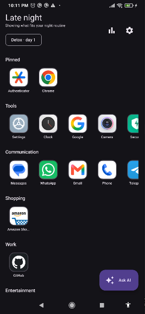
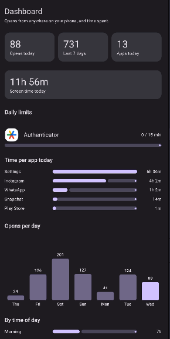
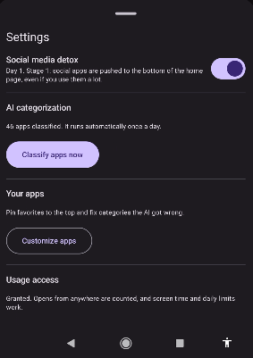
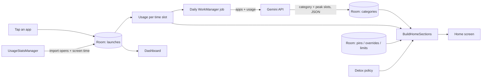

<div align="center">

# Phone Snitch

### Your phone knows what you did. Now it tells you.

An Android launcher that counts every app you open, asks an AI to judge your habits,
hides Instagram when you're being weak, and still answers your questions when you need it.


</div>

---

## Demo

<div align="center">

[](https://www.youtube.com/shorts/G2cF_R55IGk)

**[Watch the demo on YouTube](https://www.youtube.com/shorts/G2cF_R55IGk)**

</div>

---

## Screenshots

| Home | Dashboard | Settings |
|:---:|:---:|:---:|
|  |  |  |

---

## What it does

### 🏠 A home screen that adapts to the time of day
The first page shows the app categories that fit **right now**. Slack-type apps rise during work hours,
entertainment rises in the evening. The day is split into four slots: `morning` 5–8, `work_hours` 9–16, `evening` 17–21, `night` 22–4.

### 🤖 Daily AI categorization
Once a day (WorkManager) the installed apps, together with how often you open them in each slot, go to an LLM.
It returns a category for each app and the slots where that app matters most.

- Fixed category list, so the model can't invent new ones.
- Temperature 0, JSON mode, batches of 40 apps.
- Every response is validated. Unknown packages are dropped and unknown categories become `other`, so a bad answer never crashes the launcher.
- Day 1 has no usage data, so the AI classifies by app name only. From day 2 it also sees your usage.

### 🧮 How the ranking works

```
score(app, slot) = opens in this slot (last 14 days)
                 + 3 × confidence    if the AI marked this slot as a peak slot for the app
```

On day 1 the AI's `peak_slots` drive the order. As real usage builds up, it takes over naturally.
Your own choices (pins, category fixes) always beat the AI.

### 📵 Social media detox
Turn it on and social apps disappear **step by step**:

| Days since activation | What happens |
|---|---|
| 0–6 | Pushed to the bottom of the home page, even if you open them a lot |
| 7–13 | Gone from the home page completely (still in *All apps*) |
| 14+ | Also **blocked on Fridays and Saturdays**: hidden everywhere in the launcher |

The thresholds and blocked days are constants in `DetoxPolicy.kt`. The task left them open, so tune them.
Detox beats pins: a pinned social app stays out of the Pinned row while a detox is running.

### 💬 Quick Assistant
A button on the home screen. Type or speak a question (system speech recognizer, no mic permission needed),
and the answer shows up inside the launcher. There is also a "share to another AI app" fallback.

### ⭐ Customize
Pin favourite apps to the top, fix categories the AI got wrong, and set a **daily time limit** per app
(15 / 30 / 60 / 120 min). Your choices live in their own table, so the daily AI run never overwrites them.

### 📊 Dashboard (the snitching part)
- Opens today, last 7 days, distinct apps today
- Screen time today, and time per app
- Opens per day (7-day chart), by time of day, by category
- Most opened apps and a log of the most recent opens
- Progress bars for daily limits

### 🔐 Usage Access (optional, recommended)
Without it, the launcher only counts apps opened **from the launcher**.
With it (you grant it once in system settings), opens from notifications, Recents and anywhere else are counted too,
screen time appears, and daily limits start working.

---

## How it fits together



### Project structure

```
app/src/main/java/com/farah/phonesnitch/
├── domain/            models, DetoxPolicy, AppRules, use cases, repository interfaces
│   └── usecase/       BuildHomeSections, ClassifyApps, AskAssistant, BuildDashboardStats, BuildTimeStats
├── data/
│   ├── local/         Room (launches, categories, prefs) + SharedPreferences
│   ├── remote/        Retrofit + Gemini API, the prompt, JSON parsing and validation
│   ├── repository/    LauncherRepositoryImpl
│   └── system/        PackageManager launcher, UsageStatsManager scanner
├── work/              ClassifyWorker (daily, retries up to 3 times)
├── ui/                Compose screens: Home, All apps, Assistant, Customize, Dashboard, Settings
├── AppContainer.kt    manual dependency injection
└── MainActivity.kt    HOME launcher entry point
```

**Stack:** Kotlin 2.0 · Jetpack Compose (Material 3) · Room 2.6 · WorkManager 2.9 · Retrofit 2.11 + kotlinx.serialization · Coroutines/Flow · Gemini API

---

## Run it

1. Open the project in **Android Studio Ladybug (2024.2)** or newer, with **Android SDK 35**. Wait for the Gradle sync.
2. Open (or create) `local.properties` in the project root, next to `settings.gradle.kts`, and add a key from [Google AI Studio](https://aistudio.google.com/apikey). The file is git-ignored, so your key stays out of the repo:
   ```properties
   GEMINI_API_KEY=your_key_here
   GEMINI_MODEL=gemini-2.5-flash
   ```
   If you get **HTTP 404**, the model name is retired or misspelled. Pick a current one from the [model list](https://ai.google.dev/gemini-api/docs/models).
3. Run on a real phone (Android 8.0+). Press **Home** and choose **Phone Snitch → Always**.
4. In **Settings**: tap *Classify apps now* and *Grant usage access*.

**Tip for testing the detox without waiting two weeks:** set `REDUCED_DAYS` and `HIDDEN_DAYS` in `DetoxPolicy.kt` to `0` and `1`.

---

## Honest limits

- **It can count, not block.** Usage Access lets the app *measure* what you open anywhere, but the blocking (detox and daily limits) only works **inside the launcher**. An app can still be opened from a notification or Recents. Real blocking would need an Accessibility Service.
- **Numbers are approximate.** An "open" is a new foreground session: moving between screens of the same app, or a pause under 3 seconds, doesn't count twice. Compare with Digital Wellbeing if a number looks odd.
- **Android keeps usage events for only a few days**, so history from before you granted access is limited.
- **The API key ships inside the APK** (via `BuildConfig`). Fine for a learning project. For a real app, put a small backend in front of the model.
- Daily limits refresh once a minute, so you can overshoot by about a minute.


---

<div align="center">

*The snitch is you. The phone is just the witness.*

</div>